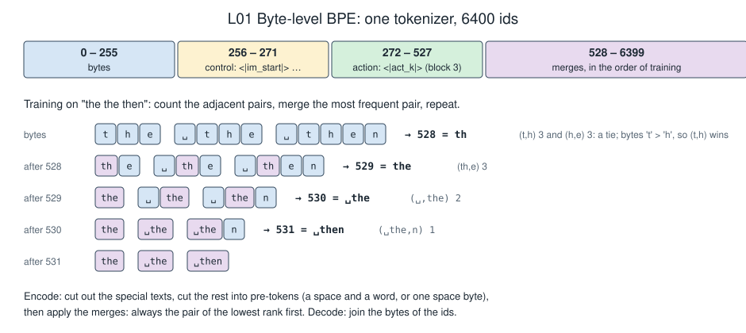

# L01 BPE tokenizer (session 1)



## Idea

Text is a sequence of bytes. BPE starts with one id for each byte (0–255). Training
counts each pair of adjacent ids and gives a new id to the most frequent pair. It
repeats until the vocabulary has 6400 ids. Two rules make Python and C++ agree to the id:

- **Pre-tokens.** A merge never crosses the edge of a pre-token. A pre-token is an optional
  space and a run of bytes that are not white space, or one white-space byte.
- **Ties.** When two pairs have the same count, the pair with the larger bytes wins.

Special texts (ids 256–527) are cut out first. They never merge: `<|im_start|>` is one id.
Encoding applies the merges in their training order: always the pair of the lowest rank first.

## You write

In `tokenizer.cpp`. The rules are in the comments of `tokenizer.hpp`.

1. `special_text`, `split_special`, `pretokenize`: walk the bytes; no regular expression is necessary.
2. `train_bpe`: count the pre-tokens one time; then loop: count the pairs, take the best, merge it.
3. `Tokenizer`: the constructor builds `vocab` and `rank`; then `encode`, `decode`, `save`, `load`.

C++: compare byte strings as `std::string` (the order is unsigned, as in Python).
`std::pair<int, int>` has no `std::hash`: use `std::map`, or write a small hash.

## Check

```bash
ctest --preset clang -L L01
```

The test trains on a small corpus with many ties and compares each merge with the
reference. Run the reference on real text (it takes 9 minutes in Python; C++ takes seconds):

```bash
uv run tools/fetch_data.py tinystories-valid
uv run python -m LLM.L01_tokenizer.tokenizer   # 5872 merges; "Once upon a time" -> 4 ids
```

## Sources

- LLMs-from-scratch `ch02/05_bpe-from-scratch/bpe-from-scratch-simple.ipynb`: BPE from scratch
- minimind `trainer/train_tokenizer.py:49-53` (special tokens), `:105-110` (start, end, padding ids)
