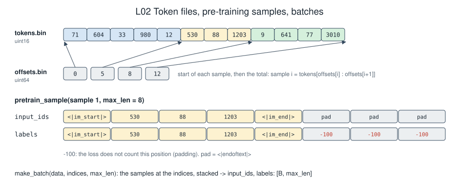

# L02 Token data (session 2)



## Idea

The tokenizer runs one time over the corpus. The ids go to two binary files:
`tokens.bin` holds all ids (uint16), and `offsets.bin` holds the start of each sample
(uint64), then the total. A sample is one story.

A pre-training sample is `[<|im_start|>] + ids + [<|im_end|>]`, cut and padded to
`max_len`. The labels are the same ids, with `-100` at the padding: the loss does not
count those positions (lesson L06). A batch stacks B samples: two tensors `[B, max_len]`.

The order of the samples changes in each epoch: `torch::randperm` (lesson L08). The test
gives the indices, so it does not depend on random numbers.

## You write

In `token_data.cpp`, with the interface in `token_data.hpp`:

1. `write_token_files` and `TokenFile`: binary files, little-endian. Write with
   `std::ofstream::write`, read the whole file with `std::ifstream::read`.
2. `tokenize_jsonl`: one JSON object on each line; take the field `"text"`. Use
   nlohmann/json: `nlohmann::json::parse(line)["text"].get<std::string>()`.
3. `pretrain_sample` and `make_batch`: `torch::full`, `Tensor::slice`, `torch::stack`.

## Check

```bash
ctest --preset clang -L L02
```

The test compares your files with the files of the reference, byte for byte. The last
test case also uses your tokenizer of L01. Run the reference (after L01):

```bash
uv run python -m LLM.L02_token_data.token_data   # 27 630 stories, 4.8 M tokens, mean 175 ids
```

## Sources

- minimind `dataset/lm_dataset.py:40-58` (`PretrainDataset`: start id, end id, padding, labels -100)
- LLMs-from-scratch `ch02/01_main-chapter-code/ch02.ipynb` (from text to batches of token ids)
