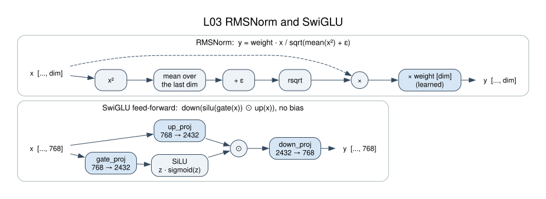

# L03 RMSNorm and SwiGLU (session 3)



## Idea

**RMSNorm** divides each vector by its root mean square, then multiplies it by a learned
weight. It comes before each sub-layer of a block, and keeps the scale of the
activations stable. Compute it in float32; return the dtype of the input.

    y = weight ⊙ x / sqrt(mean(x²) + ε)          ε = 1e-6

**SwiGLU** is the feed-forward sub-layer. One projection makes a gate, one makes a
value; the product goes back to the model width. No bias.

    y = W_down ( SiLU(W_gate x) ⊙ W_up x ),       SiLU(z) = z · sigmoid(z)

In the model of block 1: width 768, hidden width 2432 (5.6 M parameters for each SwiGLU).

## You write

In `rmsnorm_swiglu.cpp`:

1. `RMSNormImpl`: register the parameter `"weight"` (ones), then the forward pass.
2. `FeedForwardImpl`: register `"gate_proj"`, `"up_proj"`, `"down_proj"`, then the forward pass.

LibTorch: `register_parameter("weight", torch::ones({dim}))`,
`register_module("gate_proj", torch::nn::Linear(torch::nn::LinearOptions(dim, hidden).bias(false)))`,
`torch::rsqrt`, `torch::silu`, `x.to(torch::kFloat32)`, `y.to(x.scalar_type())`.
The names must be the names of the reference: the tests load its weights by name.

## Check

```bash
ctest --preset clang -L L03
uv run python -m LLM.L03_rmsnorm_swiglu.rmsnorm_swiglu   # the reference
```

## Sources

- minimind `model/model_minimind.py:50-60` (RMSNorm), `:136-146` (FeedForward)
- LLMs-from-scratch `ch05/07_gpt_to_llama/converting-gpt-to-llama2.ipynb` (RMSNorm, SiLU, SwiGLU)
