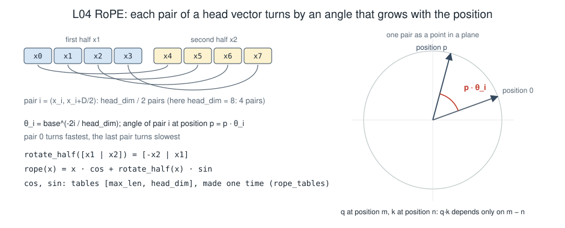

# L04 RoPE (session 4)



## Idea

Attention compares a query with a key by their dot product. RoPE puts the position
into that product. It cuts a head vector of size D into D/2 pairs `(x_i, x_{i+D/2})`
and turns pair i of the vector at position p by the angle `p · θ_i`:

    θ_i = base^(−2i / D)                       base = 1e6, D = 96
    rope(x) = x · cos(pθ) + rotate_half(x) · sin(pθ),   rotate_half([x1 | x2]) = [−x2 | x1]

A turn keeps the length of a vector. The angle between a query at position m and a key
at position n changes by `(m − n) · θ_i`, so their dot product depends only on the
distance m − n. The tables of cos and sin are made one time, for all positions.

## You write

In `rope.cpp`:

1. `rope_tables`: `torch::arange`, `torch::pow`, `torch::outer`, `torch::cat`. Follow the
   formula in `rope.hpp` step by step (float32), so that your tables agree with the reference.
2. `rotate_half`: `x.chunk(2, -1)` and `torch::cat`.
3. `apply_rope`: one line. The shapes broadcast: `[B, H, T, D]` with `[T, D]`.

## Check

```bash
ctest --preset clang -L L04
uv run python -m LLM.L04_rope.rope   # same distance, same dot product
```

The limit is 1e-5 (not 1e-6): the angle grows with the position, so two correct float32
formulas can differ more at the far positions.

## Sources

- minimind `model/model_minimind.py:62-84` (`precompute_freqs_cis`, `apply_rotary_pos_emb`)
- LLMs-from-scratch `ch05/07_gpt_to_llama/converting-gpt-to-llama2.ipynb` (RoPE)
