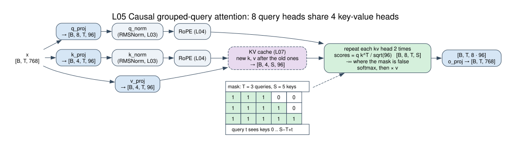

# L05 Attention (session 5, long: plan a weekend day)



## Idea

Each position makes a query q, a key k and a value v. The output of a position is the
mean of the values, weighted by how well its query agrees with each key:

    attention(q, k, v) = softmax(q kᵀ / sqrt(D) + mask) v        D = 96 (head size)

- **Causal mask:** a position sees itself and the positions before it, never after.
  With T queries and S keys (S ≥ T, lesson L07), query t sees keys 0 … S−T+t.
- **Heads:** 8 query heads look at different things. **Grouped-query attention:**
  only 4 key-value heads; query heads 2h and 2h+1 share key-value head h. This makes the
  KV cache two times smaller.
- **QK-norm:** RMSNorm on each query and key head before RoPE (Qwen3). It keeps the
  scores in a stable range.

## You write

In `attention.cpp`:

1. `causal_mask`: `torch::ones({T, S}, torch::kBool).tril(S - T)`.
2. `attend_manual`: each step of the formula, written out. Use `repeat_interleave` for the
   key-value heads, `masked_fill` with −infinity, `softmax(-1)`.
3. `attend_sdpa`: the same result with `torch::scaled_dot_product_attention` (fast; the
   model uses it). Arguments: `(q, k, v, mask, 0.0, is_causal, std::nullopt, /*enable_gqa=*/true)`.
4. `AttentionImpl`: register the six modules, then the forward pass of `attention.hpp`.
   Leave the cache path for L07: `if (cache) COURSE_TODO("Attention::forward with a cache (L07)");`

## Check

```bash
ctest --preset clang -L L05
uv run python -m LLM.L05_attention.attention   # manual and fused attention agree
```

The test also checks causality: a change at position 5 does not change outputs 0 … 4.

## Sources

- minimind `model/model_minimind.py:86-134` (`repeat_kv`, `Attention` with q_norm and k_norm)
- LLMs-from-scratch `ch03/01_main-chapter-code/ch03.ipynb` (attention, causal mask, heads),
  `ch04/04_gqa/` (grouped-query attention), `ch05/11_qwen3/` (QK-norm)
