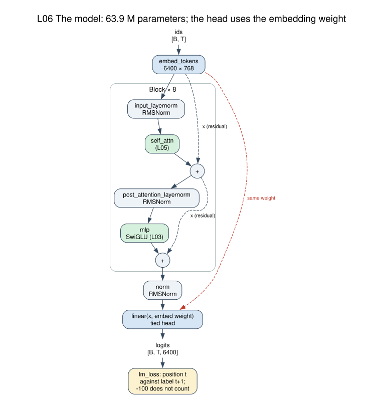

# L06 Block, model, loss (session 6)



## Idea

A **block** is two sub-layers, each with a norm before it and a residual connection
around it. The residual path carries x through all 8 blocks unchanged; each sub-layer
adds a correction to it:

    x = x + attention(RMSNorm(x))        x = x + SwiGLU(RMSNorm(x))

The **model**: embedding → 8 blocks → RMSNorm → logits. The head uses the weight of the
embedding (tied): `logits = h · Eᵀ`. This saves 4.9 M parameters; the total is 63.9 M.

The **loss** is next-token cross-entropy: the logits of position t against the id of
position t+1. Labels of −100 (padding) do not count. A random model gives
ln 6400 ≈ 8.76. All matrices start from N(0, 0.02²); the norm weights start at 1.

## You write

In `model.cpp`:

1. `BlockImpl`: register the four modules (names in `model.hpp`); the forward pass is 2 lines.
2. `ModelImpl`: `torch::nn::Embedding`, a `torch::nn::ModuleList` of `Block`s, the RMSNorm,
   and the RoPE tables of L04 as the buffers `"cos"` and `"sin"` (`register_buffer`).
   Forward: `layers[i]->as<BlockImpl>()->forward(...)`; the head: `torch::nn::functional::linear`.
   Leave the cache offset for L07 (start at position 0).
3. `lm_loss`: `slice` the logits and the labels, then `torch::nn::functional::cross_entropy`
   with `CrossEntropyFuncOptions().ignore_index(-100)`.
4. `init_weights`, `save_checkpoint`, `load_checkpoint`: a checkpoint is a dictionary,
   parameter name → tensor (`course::read_tensors`, `course::write_tensors`).

## Check

```bash
ctest --preset clang -L L06
uv run python -m LLM.L06_model.model   # 63,912,192 parameters; loss near 8.76
```

`L06_model_py` is the second test: Python reads the checkpoint that your C++ wrote.

## Sources

- minimind `model/model_minimind.py:183-258` (block, model, tied head, shifted loss)
- LLMs-from-scratch `ch04/01_main-chapter-code/ch04.ipynb` (the GPT model),
  `ch05/07_gpt_to_llama/converting-llama2-to-llama3.ipynb` (weight tying)
