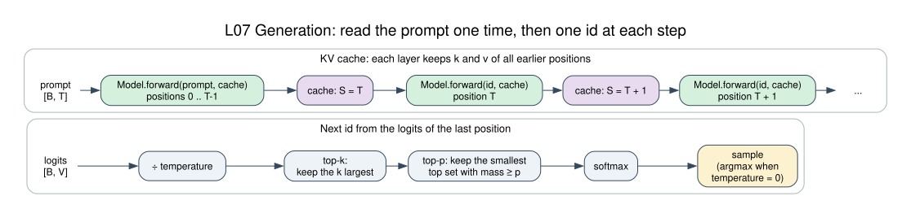

# L07 Generation and KV cache (session 7)



## Idea

The model gives the logits of the next id. Generation repeats: choose an id, append
it, run the model again. Without a cache, each step reads the whole sequence again.
With the **KV cache**, each layer keeps the keys and values of all earlier positions:
the first step reads the prompt, and each next step reads only one new id. RoPE starts
at the position after the cache.

The next id comes from the logits of the last position:

- greedy: the argmax (temperature 0);
- sampled: divide by the temperature, keep the k largest (top-k), keep the smallest top
  set with probability mass ≥ p (top-p), softmax, then draw one id.

## You write

1. In `attention.cpp` (L05): the cache path. Put the new k and v after the cached ones
   (`torch::cat` on dimension 2) and store them in the cache.
2. In `model.cpp` (L06): the start position is the length of the cache.
3. In `generate.cpp`: `filter_probs` (`topk`, `sort`, `cumsum`, `scatter`) and `generate`
   (`torch::NoGradGuard`, `argmax`, `torch::multinomial`).

## Check

```bash
ctest --preset clang -L L07
uv run python -m LLM.L07_generation.generate   # same ids with and without the cache
```

The test compares the logits of each cached step with the logits of the whole
sequence, the greedy ids with the reference, and the probabilities after the filters.
Sampled ids are not compared: they depend on random numbers.

## Sources

- minimind `model/model_minimind.py:262-293` (`generate`: temperature, top-k, top-p, cache, eos)
- LLMs-from-scratch `ch05/01_main-chapter-code/ch05.ipynb` (temperature, top-k), `ch04/03_kv-cache/`
