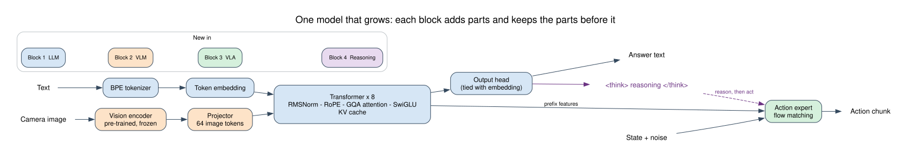

# Block 1: LLM (sessions 1 to 14)

Product: a chat model of 63.9 M parameters that thinks before it answers.
Design: Qwen3 at a small size (byte-level BPE, RMSNorm, RoPE, grouped-query
attention, SwiGLU, tied embedding). The lesson table and the data are in
[`docs/specification.md`](../docs/specification.md), section S-5.

| Week | Sessions | Lessons | Milestone |
|------|----------|---------|-----------|
| 1 | 1 to 7 | L01 tokenizer to L07 generation and KV cache | M1a |
| 2 | 8 to 14 | L08 training loop to L12 chat program, two training runs, 2 reserve sessions | M1b |

The lessons come with milestones M1a and M1b.
