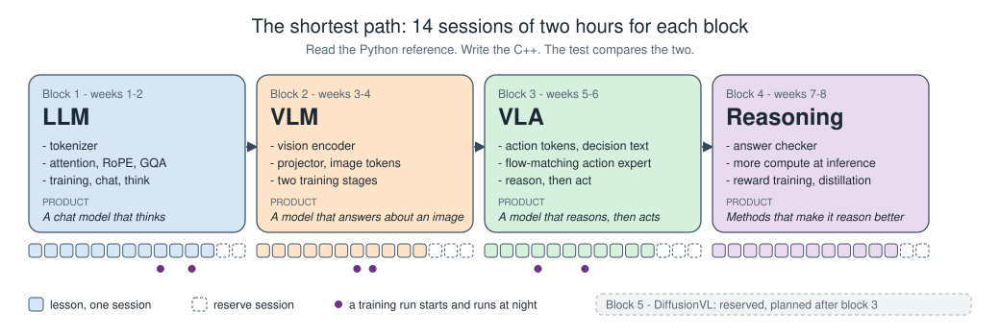
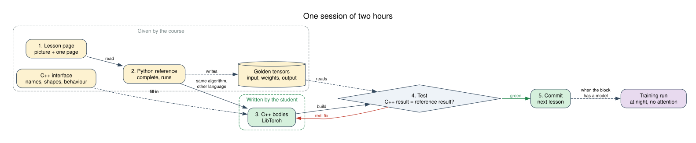

# LLM_from_scratch



A lean course. One model grows from a language model (LLM) to a
vision-language model (VLM) to a vision-language-action model (VLA). Then it
learns to reason. Each lesson gives a short Python reference. You write the
same algorithm in C++23 with LibTorch. A test compares your tensors with the
tensors of the reference. Part of EVA; the rules are in [`AGENTS.md`](AGENTS.md).

| Document | Content |
|----------|---------|
| [`plans/objective-1-lean-course.md`](plans/objective-1-lean-course.md) | Plan: blocks, milestones, decisions |
| [`docs/requirements.md`](docs/requirements.md) | What the course must do |
| [`docs/specification.md`](docs/specification.md) | How: technology, lessons, data |
| [`LLM/README.md`](LLM/README.md) | Block 1, the first lessons |

## Before you start

- Linux, an NVIDIA graphics processor of 24 GB, driver 580 or above
- [uv](https://docs.astral.sh/uv/), CMake 3.28 or above, Ninja, Clang 21 or GCC 15

> **Do not set `UV_PROJECT_ENVIRONMENT` in your shell.** If it is set, `uv sync`
> puts the environment of this project in that folder, and replaces the
> environment that is there. The build looks for LibTorch in `.venv/` only.
> Remove it from `~/.bashrc`, or type `unset UV_PROJECT_ENVIRONMENT` first.

## Quick start

```bash
uv sync                          # Python 3.13 and PyTorch 2.15.0; LibTorch is in the package
cmake --preset clang             # or: cmake --preset gcc
cmake --build --preset clang
ctest --preset clang -L smoke    # LibTorch on the CPU and the GPU; tensors Python <-> C++
```

All tests of the course make their golden files first: CTest runs
`tools/make_goldens.py`, which does no work when no reference changed.

## One lesson



```bash
ctest --preset clang -L L03      # red: "not implemented: RMSNorm::RMSNorm"
# write the bodies in LLM/L03_rmsnorm_swiglu/rmsnorm_swiglu.cpp
cmake --build --preset clang && ctest --preset clang -L L03   # green
```

Read the lesson page (`README.md` in the lesson folder) and the Python
reference first. Run the reference: `uv run python -m LLM.L03_rmsnorm_swiglu.rmsnorm_swiglu`.

## Data

```bash
uv run tools/fetch_data.py --list               # items, sizes, licences
uv run tools/fetch_data.py tinystories-valid    # 22.5 MB, enough for lessons L01 and L02
```

The files go into `data/`, which is not in git. Each item has a pinned revision.

## Layout

| Folder | Content |
|--------|---------|
| `LLM/`, `VLM/`, `VLA/`, `Reasoning/`, `DiffusionVL/` | The blocks. One folder for each lesson. |
| `course/cpp/`, `course/py/` | Shared helpers: golden files, tensor compare, arguments, CSV log. No model logic. |
| `tools/` | `fetch_data.py`, `make_goldens.py`, `make_figures.py` |
| `cmake/` | LibTorch target, header-only libraries, test helpers |
| `data/`, `runs/`, `build/` | Not in git: data, goldens, checkpoints, build trees |
