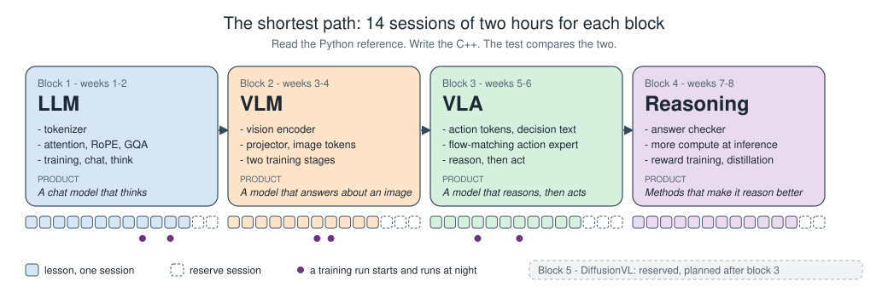

# Requirements: the lean course

This document says **what** the course must do. It names no technology,
with one exception: C++, because the project is defined by it (see
`AGENTS.md`). The technology is in [`specification.md`](specification.md).

## Purpose

The course brings one student from an empty file to a
vision-language-action model that reasons, by the shortest path.
The student writes each part.

## R-1 Scope and path

| Id | Requirement |
|----|-------------|
| R-1.1 | The course has ordered blocks: language model, vision-language model, vision-language-action model, reasoning. |
| R-1.2 | Each block gives a model that runs: it trains on the machine of the student and gives an output that a person can examine. |
| R-1.3 | Each block starts from the product of the block before it. |
| R-1.4 | The course teaches one method for each function: one tokenizer, one attention mechanism, one normalization, one position method, one training procedure. |
| R-1.5 | The method is the one that current models use. The course does not teach how the field got there. |
| R-1.6 | The content comes from the two source courses where they cover the subject. Where they do not, the course names its other source. |
| R-1.7 | A block can be added later and it does not change the blocks before it. |

## R-2 Time

| Id | Requirement |
|----|-------------|
| R-2.1 | One lesson fits in one session of two hours. |
| R-2.2 | One block fits in 14 sessions. At least two of the 14 sessions are reserve. |
| R-2.3 | A training run uses no session time. It runs without attention between two sessions. |
| R-2.4 | Each training run completes in less than eight hours on the machine of the student. |
| R-2.5 | A failure in one block does not stop the next block: the course supplies a fallback product for each block. |

## R-3 The lesson

| Id | Requirement |
|----|-------------|
| R-3.1 | Each lesson has one page of text. The page starts with a picture. |
| R-3.2 | Each lesson has a complete reference implementation that runs. |
| R-3.3 | The reference is in a language that is different from the language of the student. Thus the student writes the code and cannot copy it. |
| R-3.4 | The reference is short and clear. It has no feature that the lesson does not teach. |
| R-3.5 | Each lesson gives the interface of the code that the student writes: names, inputs, outputs, shapes and behaviour. The bodies are empty. |
| R-3.6 | Each lesson has an automatic test. The test compares the result of the student with the result of the reference on the same input. |
| R-3.7 | The test fails before the student writes the code. The test passes after the student writes correct code. |
| R-3.8 | Each test is proven passable before the course is released. |
| R-3.9 | The repository holds no solution in the language of the student. |

## R-4 The code of the student

| Id | Requirement |
|----|-------------|
| R-4.1 | The student writes in C++, standard 23 or above. |
| R-4.2 | The code of the student does all the work of the model: tokens, data loading, model, training, inference. |
| R-4.3 | A training run or an inference run of the model of the student does not use the reference language. Tools that download or convert data can use it. |
| R-4.4 | The model of the student and the reference model exchange weights in the two directions. |

## R-5 Proof

| Id | Requirement |
|----|-------------|
| R-5.1 | Each block has an exit test with a number: a loss limit or a success rate. |
| R-5.2 | The course records the results of the reference training: loss curve, time, hardware. The student compares the two curves. |
| R-5.3 | The build and the tests work from a clean clone, with one documented sequence of commands. |
| R-5.4 | A report says the truth: a test that fails is reported as a failure, with its output. |

## R-6 Text and data

| Id | Requirement |
|----|-------------|
| R-6.1 | The text is in Simplified Technical English (ASD-STE100). |
| R-6.2 | A picture, a graph or a workflow comes before the text that it explains. |
| R-6.3 | The training data is English. |
| R-6.4 | The licence of each data set and of each pre-trained weight permits study. The course records each licence. |

## R-7 Constraints

| Id | Requirement |
|----|-------------|
| R-7.1 | The course runs on Linux, on one machine with one graphics processor of 24 GB. Other work can hold a part of that memory. |
| R-7.2 | The repository is public. It holds no data set, no weight file and no personal detail. |
| R-7.3 | Each change lands by merge request (see `AGENTS.md`). |

## Out of scope

- Methods that the course replaces with a newer one (R-1.5).
- More than one graphics processor, and remote training.
- Service, user interface and deployment of the models.
