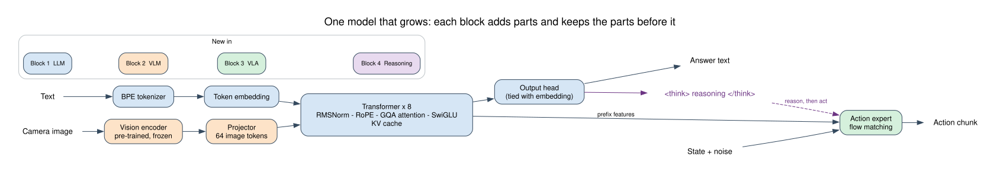
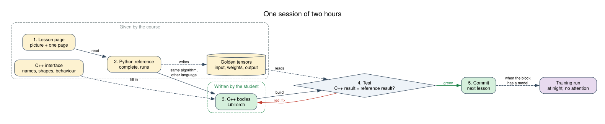

# Specification: the lean course



This document says **how** the course does what
[`requirements.md`](requirements.md) asks. It names the technology.
A fact with the mark ✔ was tested on the machine of the student on
2026-11-16. The other facts come from the source that the line names.

## S-1 Technology

| Function | Technology | Reason |
|----------|------------|--------|
| Reference language (R-3.3) | Python 3.13, PyTorch 2.15.0 | The two source courses use PyTorch. |
| Language of the student (R-4.1) | C++23, LibTorch 2.15.0 | LibTorch is the C++ library of PyTorch: same tensors, same functions. |
| One binary for the two sides | LibTorch is the `torch/` folder of the PyTorch package in the Python environment of the project | The reference and the student call the same compiled code. On the CPU the two results are equal to the last bit ✔. |
| Compilers | Clang 21 is the default: a rebuild after an edit takes 4 s ✔. GCC 15 also builds: 15 s ✔. | The two compile LibTorch headers at `-std=c++23` with no error ✔. |
| Build | CMake 3.28 or above with presets, Ninja, a precompiled header for `<torch/torch.h>` | One translation unit that includes LibTorch compiles in 16 s without the precompiled header ✔. |
| Python environment | `uv` with `pyproject.toml` and a lock file | The lock file pins PyTorch, and thus LibTorch. |
| Tests | CTest starts the tests; doctest gives the test cases | doctest is one header. |
| Small libraries | nlohmann/json (JSON), stb_image (JPEG and PNG) | Header-only. CMake `FetchContent` gets them at a pinned version. |
| Tensor exchange (R-4.4) | Python to C++: `torch.save(dict)`, then `torch::pickle_load` ✔. C++ to Python: `torch::pickle_save`, then `torch.load` with one allowed name, `torch.jit._pickle.restore_type_tag` ✔. The helper `course/py/io.py` holds this setting. | No other library is necessary. |
| Mixed precision | `at::autocast` with `bfloat16` on the graphics processor ✔ | Same speed-up as the reference. |
| Package for the graphics processor | PyTorch 2.15.0 `cu132` (CUDA 13.2). It needs driver 580 or above; the machine has 595. | The 3090 tests of this document used the 2.9.1 package on the machine. The CPU tests used 2.15.0. |
| What LibTorch has | AdamW, gradient clip, the attention operator `torch::scaled_dot_product_attention` ✔, the autocast switches ✔, a data loader | The lessons use them. |
| What LibTorch lacks | An RMSNorm module, a cosine schedule, an autocast guard | The student writes them (L03, L08). |

### Machine traps and their control

These three faults were found by test ✔. The build files of the course
prevent them.

| Trap | Effect | Control |
|------|--------|---------|
| The shell exports `TORCH_ROOT`, which points to an old PyTorch 2.9.1. | `find_package(Torch)` takes the old library and ignores `CMAKE_PREFIX_PATH`. | The course does not call `find_package(Torch)`. |
| `find_package(Torch)` of a build for the graphics processor starts the CUDA compiler. The CUDA 12.4 and 12.8 toolkits on the machine refuse GCC 15 and Clang 21, and fail on the headers of the system C library. | The configure step fails. | Same control. No CUDA toolkit is necessary: the PyTorch package brings its CUDA libraries. |
| A global `CMAKE_CXX_STANDARD 23` goes into the CUDA probe. | The configure step fails. | The standard is set for each target: `target_compile_features(<target> PRIVATE cxx_std_23)`. |

The control is one file, `cmake/LibTorch.cmake`. It makes an interface
target from the two folders of the package. This text ran on the graphics
processor with the two compilers ✔. That run used the PyTorch 2.9.1
package that is on the machine. Milestone M0 repeats it with 2.15.0:

```cmake
set(LIBTORCH_DIR "" CACHE PATH "The torch/ folder of the PyTorch package")
add_library(libtorch INTERFACE)
target_include_directories(libtorch SYSTEM INTERFACE
    "${LIBTORCH_DIR}/include" "${LIBTORCH_DIR}/include/torch/csrc/api/include")
target_link_directories(libtorch INTERFACE "${LIBTORCH_DIR}/lib")
target_link_libraries(libtorch INTERFACE torch torch_cpu c10)
if(EXISTS "${LIBTORCH_DIR}/lib/libtorch_cuda.so")
    target_link_libraries(libtorch INTERFACE
        -Wl,--no-as-needed torch_cuda c10_cuda -Wl,--as-needed)
endif()
target_link_options(libtorch INTERFACE "-Wl,-rpath,${LIBTORCH_DIR}/lib")
```

`CMakePresets.json` sets `LIBTORCH_DIR` to
`${sourceDir}/.venv/lib/python3.13/site-packages/torch`.

## S-2 Repository layout

```
LLM_from_scratch/
├── AGENTS.md  README.md  plans.csv
├── plans/                     plans, named by rule 6
├── docs/                      requirements.md, specification.md, img/
├── CMakeLists.txt  CMakePresets.json  cmake/LibTorch.cmake
├── pyproject.toml  uv.lock    reference environment; it holds LibTorch
├── course/                    shared parts, written by the course
│   ├── cpp/                   golden reader, tensor compare, argument parser, CSV log
│   └── py/                    golden writer, seed, data readers
├── tools/                     fetch_data.py, make_goldens.py, export_weights.py, plot_curves.py
├── LLM/                       block 1: L01_… to L12_…, apps/, curves/, README.md
├── VLM/                       block 2: V01_… to V11_…, apps/, curves/, README.md
├── VLA/                       block 3: A01_… to A12_…, apps/, curves/, README.md
├── Reasoning/                 block 4
├── DiffusionVL/               block 5, reserved
├── data/                      not in git: data sets, token files, pre-trained weights
└── runs/                      not in git: checkpoints and logs of training runs
```

`course/cpp/` holds no model logic. All model logic is in the lesson
folders.

One lesson is one folder:

```
LLM/L05_attention/
├── README.md             lesson page: picture first, then one page
├── attention.py          Python reference: complete, runs, writes the golden file
├── attention.hpp         C++ interface: declarations and doc comments
├── attention.cpp         C++ bodies: empty; the student writes them
└── attention_test.cpp    C++ test: reads the golden file, calls the student code
```



## S-3 Lesson contract

| Part | Writer | Rule |
|------|--------|------|
| Lesson page `README.md` | course | 60 lines maximum. Order: picture (SVG), idea (10 lines of mathematics maximum), "You write", "Check" (the test command), "Sources" (file and line in the two source courses). |
| Python reference `.py` | course | Complete and runs. 150 lines maximum for each lesson. Imports: `torch`, the standard library, and earlier lessons. A comment gives the shape at each tensor line. No option that the lesson does not teach. |
| Golden file | generated | The reference writes it with a fixed seed: input, weights, output. It is not in git. `tools/make_goldens.py` makes all of them. |
| C++ interface `.hpp` | course | Declarations only. Each function has a doc comment: purpose, shapes, behaviour, limits. |
| C++ bodies `.cpp` | **student** | Each body starts as `COURSE_TODO("name");`. This macro throws `course::NotImplemented`. |
| C++ test `_test.cpp` | course | Red before the student writes the body: the report is `not implemented: name`. Green after. |
| Programs `apps/*.cpp` | course writes `main()`; **student** writes what it calls | `main()` reads the arguments and calls the functions of the lessons. |

Proof that each test can pass (R-3.8): the agent that makes a lesson
writes a C++ solution in a temporary folder outside the repository, gets
the test green, and deletes the solution. The merge request has a table
with two columns for each test: red with the empty bodies, green with
the temporary solution.

## S-4 Proof

| Subject | Rule |
|---------|------|
| Device and type of the tests | CPU, `float32`. One smoke test for each block runs on the graphics processor. |
| Limit, one module | Largest absolute difference 1e-6 or less. |
| Limit, full model | Largest absolute difference 1e-5 or less on the logits. |
| Token ids, text, merges | Equal. |
| Random numbers | A test does not depend on equal random streams. The golden file brings all weights. A sampling test compares the probabilities after the filters. |
| Weights exchange | A checkpoint is a dictionary: parameter name to tensor. The names are the names of the reference. Each block has a test in the two directions. |
| Training curve (R-5.2) | The reference run writes `curves/<run>.csv`: step, loss, learning rate, seconds. This file is in git. The C++ run writes the same columns. `tools/plot_curves.py` puts the two curves in one picture. |
| Fallback (R-2.5) | The reference run keeps its last checkpoint in `runs/reference/`. The next block can start from it. |

## S-5 Block 1: LLM (sessions 1 to 14)

The model is the Qwen3 design at a small size. The two source courses
end at this design: `minimind` `model/model_minimind.py` and
`LLMs-from-scratch` `ch05/11_qwen3`.

| Part | Choice | Value |
|------|--------|-------|
| Tokens | Byte-level BPE, trained by the student | 6400 ids |
| Embedding | Tied with the output head | 6400 × 768 |
| Position | RoPE on queries and keys | base 1e6 |
| Normalization | RMSNorm before each sub-layer | eps 1e-6 |
| Attention | Causal, grouped-query, RMSNorm on queries and keys, no bias | 8 query heads, 4 key-value heads, head size 96 |
| Feed-forward | SwiGLU, no bias | hidden size 2432 |
| Depth | Transformer blocks | 8 |
| Size | Computed from the values above | 63.9 M parameters |
| Loss | Cross-entropy on the next token | ignore index −100 |
| Optimizer | AdamW, cosine schedule `lr·(0.1 + 0.45·(1 + cos(π·step/total)))`, gradient clip 1.0, gradient accumulation, `bfloat16` | pre-training: lr 5e-4, batch 32 × 8 |
| Generation | Temperature, top-k, top-p, KV cache | |

Token ids: 0 to 255 are the bytes. Ids 256 to 527 are reserved: control
tokens (`<|endoftext|>`, `<|im_start|>`, `<|im_end|>`, `<think>`,
`</think>`, `<|image_pad|>`, spare ids) and 256 action tokens
(`<|act_0|>` to `<|act_255|>`). Ids 528 to 6399 are the merges. Thus one
tokenizer and one embedding table serve all blocks (R-1.7).

Pre-token rule of the tokenizer: the control tokens are cut out first.
Then a pre-token is one optional space and a run of bytes that are not
white space; each other white-space byte is one pre-token. A merge does
not go across two pre-tokens. Ties in the merge count go to the pair
that is larger in byte order. This rule gives equal merges in Python and
in C++ with no regular-expression library.

Chat format (ChatML, as in the two source courses):

```
<|im_start|>user\n{question}<|im_end|>\n<|im_start|>assistant\n<think>\n{reasoning}\n</think>\n\n{answer}<|im_end|>\n
```

| Session | Lesson | The student writes | Test | Source |
|---------|--------|--------------------|------|--------|
| 1 | L01 BPE tokenizer | train merges, encode, decode, control tokens | merges and ids equal | rasbt `ch02/05_bpe-from-scratch`; minimind `trainer/train_tokenizer.py` |
| 2 | L02 Token data | token file writer and reader, pre-training sample (start id, ids, end id, pad, label −100), shuffled batches | batch tensors equal | minimind `dataset/lm_dataset.py:40-58`; rasbt `ch02` |
| 3 | L03 RMSNorm and SwiGLU | `RMSNorm`, `FeedForward` | output equal | minimind `model_minimind.py:50-60,136-146` |
| 4 | L04 RoPE | cosine and sine tables, rotation of queries and keys | tables and rotated tensors equal | minimind `:62-84`; rasbt `ch05/07_gpt_to_llama` |
| 5 ◆ | L05 Attention | grouped-query attention with the causal mask: by hand, then with `scaled_dot_product_attention` | output equal; the two paths equal | minimind `:86-134`; rasbt `ch03`, `ch04/04_gqa` |
| 6 | L06 Block, model, loss | `Block`, `Model`, tied head, loss, load of a checkpoint | logits and loss equal on a reference checkpoint; 63.9 M parameters | minimind `:183-258`; rasbt `ch04` |
| 7 | L07 Generation and KV cache | greedy, temperature, top-k, top-p; KV cache | greedy ids equal; logits with cache equal logits without | minimind `:262-293`; rasbt `ch05`, `ch04/03_kv-cache` |
| 8 ◆ | L08 Training loop | schedule, AdamW step, accumulation, clip, `bfloat16`, checkpoint save and resume, CSV log | schedule equal; one batch goes below loss 0.1; resume gives the same next loss | minimind `trainer/train_pretrain.py`; rasbt `ch05`, `appendix-D` |
| 9 | L09 Evaluation, then the pre-training run | validation loss and perplexity; start of the run | validation loss equal on a reference checkpoint | minimind `README` "Pretraining"; rasbt `ch05` |
| 10 | L10 Chat format and fine-tune data | chat format, sample with the loss on assistant tokens only | text and labels equal | minimind `lm_dataset.py:61-123`; rasbt `ch07` |
| 11 | L11 Think tokens, then the fine-tune run | think block in the format, think switch, mix of data; start of the run | format equal for switch on and off | minimind `README` "Adaptive Thinking" |
| 12 | L12 Chat program and exit test | chat loop with stream output and KV cache | exit test | minimind `eval_llm.py`; rasbt `ch07` |
| 13, 14 | Reserve | | | |

◆ = long lesson. Put it on a weekend day.

| Run | Data | Starts after | Limit of time (R-2.4) |
|-----|------|--------------|-----------------------|
| Pre-training | TinyStories V2 (2.7 M stories), and the English caption text of the block 2 data as plain text | session 9 | 3 hours |
| Fine-tune (chat and think) | `smol-smoltalk` (chat), `smoltalk2` think splits, arithmetic with steps from a tool | session 11 | 3 hours |

Each limit is a maximum. The reference run measures the speed and sets
the part of the data that fits the limit. This rule is the same in all
blocks.

What to expect from 63.9 M parameters: the model writes correct simple
English and holds a short conversation. It knows few facts. The caption
text in the pre-training gives it the words that block 2 needs.

Exit test of block 1: (1) the validation loss of the C++ pre-training run
is not more than 1.05 times the loss of the reference run; (2) with the
think switch on, 95 of 100 fixed questions give a complete think block
and then an answer; with the switch off, none gives a think block.

Left out of block 1: learned position embedding, LayerNorm, GELU,
dropout, mixture of experts, long-context RoPE scaling, LoRA, tool
calls, preference training, more than one graphics processor.

## S-6 Block 2: VLM (sessions 15 to 28)

The design is `minimind-v` `model/model_vlm.py`: a frozen pre-trained
vision encoder, a projector, and image tokens that go into the token
sequence of the LLM of block 1.

| Part | Choice | Value |
|------|--------|-------|
| Image | 256 × 256, three channels | scale by 1/255, then mean 0.5 and standard deviation 0.5 for each channel. The images of the data are 256 × 256 already. |
| Vision encoder | SigLIP2 base, patch 32, pre-trained, frozen. The student writes the forward pass and loads the weights. | `google/siglip2-base-patch32-256`, Apache-2.0: 12 blocks, width 768, 12 heads, feed-forward 3072, 87.5 M parameters without the pooling head |
| Image tokens | The encoder output before the pooling head | 64 tokens × 768 |
| Projector | LayerNorm, Linear, GELU, Linear | 768 to 768 |
| Splice | The prompt holds 64 image-pad ids (S-5). The projector output replaces their embeddings. | |
| Stage 1 | Train the projector only | lr 4e-4 |
| Stage 2 | Train the projector and the first and last LLM blocks | lr 5e-6 |

The vision encoder is the one place where the course uses LayerNorm,
GELU, bias and a learned position embedding: the pre-trained weights
need them.

| Session | Lesson | The student writes | Test | Source |
|---------|--------|--------------------|------|--------|
| 15 | V01 Image to tensor | JPEG decode, scale, normalize | mean difference below one grey level of 255 (the two JPEG decoders are different programs) | minimind-v `model_vlm.py:61-65` |
| 16 | V02 Patch and position embedding | patch projection, position table | output equal | SigLIP2 vision tower |
| 17 | V03 Encoder block | attention without mask, LayerNorm, GELU feed-forward | output equal | SigLIP2 vision tower; rasbt `ch03`, `ch04` |
| 18 | V04 Vision tower | all blocks, load of the pre-trained weights | 64 × 768 output equal to the pre-trained model, 1e-4 or less | minimind-v `model_vlm.py:45-73` |
| 19 | V05 Projector and splice | projector, replacement of the image-token embeddings | output equal | minimind-v `:23-33,75-96` |
| 20 ◆ | V06 VLM model | forward, loss, the sets of frozen parameters for the two stages | logits and loss equal; count of trainable parameters equal | minimind-v `:98-163`; `trainer/train_sft_vlm.py` |
| 21 | V07 Image-text data, then the stage 1 run | reader of image-text samples, chat format with an image; start of the run | batch equal | minimind-v `dataset/lm_dataset.py` |
| 22 | V08 Stage 2, then the stage 2 run | change of the trainable set, lower learning rate; start of the run | trainable set equal | minimind-v `README` "Training" |
| 23 | V09 Image chat program | chat loop with an image | answers on 20 fixed images, read by the student | minimind-v `eval_vlm.py` |
| 24 | V10 Two images in one prompt | more than one image slot (two cameras, or two moments) | output equal | minimind-v `model_vlm.py:114-127` |
| 25 | V11 Encoder output cache and exit test | file cache of the 64 × 768 output | cache equal; exit test | — |
| 26, 27, 28 | Reserve | | | |

| Run | Data | Starts after | Limit of time |
|-----|------|--------------|---------------|
| Stage 1 | `minimind-v_dataset` `pretrain_i2t.parquet`, English rows: about 675 000 images with a caption | session 21 | 4 hours |
| Stage 2 | `minimind-v_dataset` `sft_i2t.parquet`, English rows: about 1.5 M images with a question and an answer | session 22 | 6 hours |

Exit test of block 2: the validation loss of the C++ stage 2 run is not
more than 1.05 times the loss of the reference run, and the vision
tower test of V04 is green.

## S-7 Block 3: VLA (sessions 29 to 42)

The two source courses stop at the VLM. Block 3 takes the Alpamayo-R1
design (NVIDIA, a reasoning VLA for driving) at a small size. Its three
parts are the three parts of the block: action tokens, a flow-matching
action expert, and a text decision before the action. The code sources
are `openvla` (action tokens), `openpi` `pi0.py` (flow matching), and
`NVlabs/alpamayo` (action space, expert on the KV cache).

| Part | Choice | Value |
|------|--------|-------|
| Domain | Driving: front camera, ego signals, one instruction for each episode | |
| Data | `yaak-ai/L2D`, tag R1, front camera only. Apache-2.0, open. | 1000 episodes, 221 421 frames, 6.2 hours, 350 instructions, 12.3 GB |
| First tests | `yaak-ai/L2D`, tag R0, front camera only | 100 episodes, 1.6 GB |
| Observation | Two frames (0.5 s before, and now) at 256 × 256; ego state | 128 image tokens |
| Action | 64 steps of (acceleration, curvature), one step each 0.1 s. A unicycle model changes them into x, y, heading. | 6.4 s |
| Action tokens | 256 equal bins for each value; the 256 action ids of S-5 | 128 tokens for one trajectory |
| VLA-0 | The VLM writes the action tokens. Loss: cross-entropy. | |
| Flow matching | `x_t = t·noise + (1−t)·action`; target `noise − action`; `t` from `Beta(1.5, 1)·0.999 + 0.001`; 10 Euler steps from `t = 1` to `t = 0` | same values in pi0, SmolVLA and Alpamayo |
| Action expert (VLA-1) | 8 blocks of the block-1 design at width 384, about 18 M parameters. In block *i*, the attention also reads the keys and values of VLM block *i*: the KV cache of lesson L07. The VLM is frozen. | |
| Decision text | Before the trajectory, the VLM writes one speed decision and one steering decision from a closed set. | labels by rule from the future trajectory |
| Metric | Open loop, on episodes that the training did not see: average and final displacement error at 6.4 s (ADE, FDE); accuracy of the decision; agreement of decision and trajectory | |

| Session | Lesson | The student writes | Test | Source |
|---------|--------|--------------------|------|--------|
| 29 | A01 Driving episodes | sample reader, action from speed and heading, unicycle integration, normalization | action and trajectory equal | alpamayo `action_space/unicycle_accel_curvature.py` |
| 30 | A02 Action tokens | bins to tokens and back, prompt with a trajectory | tokens equal; round-trip error below half a bin | openvla `prismatic/vla/action_tokenizer.py` |
| 31 | A03 Decision text | labels by rule, prompt with instruction, decision, trajectory; decision switch (as the think switch of L11) | labels and prompt equal | Alpamayo-R1 paper, "Chain of Causation"; pi0.5 paper, subtask text |
| 32 | A04 VLA-0, then its run | training sample, ADE and FDE; start of the run | loss and metric equal | Alpamayo-R1 paper, "action injection" |
| 33 | A05 Flow matching on a 2-D toy | loss, time sampling, Euler sampler | loss equal; samples land on the target shape | openpi `models/pi0.py` |
| 34 ◆ | A06 Action expert | time embedding, action and state projection, blocks that read the KV cache | output equal | openpi `models/pi0.py`, `gemma.py` |
| 35 | A07 Flow training step and sampler, then the VLA-1 run | training step with the frozen VLM, 10-step sampler; start of the run | loss equal; sampler output equal for a fixed noise | alpamayo `diffusion/flow_matching.py` |
| 36 | A08 Reason, then act | inference: the VLM writes the decision, then the expert reads the KV cache that includes it | agreement metric equal | Alpamayo-R1 paper |
| 37 | A09 Compare | evaluation program: VLA-0 and VLA-1, decision switch on and off | table: ADE, FDE, agreement, time for one trajectory | — |
| 38 | A10 Speed | the prefix KV cache serves all 10 steps; 5 steps against 10 | same output as without the cache; trajectories for each second | pi0 paper |
| 39 | A11 Drive program and exit test | replay of one episode: frames in, decision and trajectory out, CSV for a plot | exit test | — |
| 40, 41, 42 | Reserve | | | |

The order is the order of Alpamayo-R1: action tokens, then decision
text, then the action expert. Half of the training samples of VLA-0 have
the decision text. Thus one VLM serves the two positions of the switch,
and the expert trains one time.

| Run | Trains | Starts after | Limit of time |
|-----|--------|--------------|---------------|
| VLA-0 | VLM on decision text and action tokens | session 32 | 4 hours |
| VLA-1 | action expert, VLM frozen | session 35 | 4 hours |

Exit test of block 3: the ADE of the C++ VLA-1 is not more than 1.05
times the ADE of the reference run, and the drive program gives a
decision and a trajectory for each frame of one held-out episode.

Limits of block 3, said plainly:

- The metric is open loop. A closed-loop test needs a simulator, and the
  images of a simulator are different from the camera images of the data.
  MetaDrive is the light candidate (Apache-2.0; its headless mode is
  documented, not tested here). AlpaSim with an Alpamayo driver needs
  about 40 GB of graphics memory, more than the machine has.
- The decision text gives the decision, not its cause. The open data has
  no cause labels. The cause labels of NVIDIA (Chain of Causation) are
  under a licence that the student must read first.

Second domain, if the student chooses it: robot arm, `lerobot/libero`
(Apache-2.0, 1.9 GB, 1693 episodes, 40 instructions, two cameras
256 × 256, state 8, action 7) with the LIBERO simulator for a
closed-loop success rate. Only A01, A03 and A11 change.

## S-8 Block 4: Reasoning (sessions 43 to 56)

Block 4 gets its own plan, `plans/objective-1-reasoning-block.md`, after
block 1 is delivered. This section fixes its outline only. The source is
`rasbt/reasoning-from-scratch`; `minimind` gives the reward-training
code at a small size.

| Step | Subject | Source |
|------|---------|--------|
| 1 | Answer checker: find the final answer in the text and compare it | reasoning `ch03` |
| 2 | More compute at inference: sample many answers and vote | reasoning `ch04` |
| 3 | Self-refinement: score an answer and write it again | reasoning `ch05` |
| 4 | Reward training: rollouts, reward from the checker, the GRPO loss | reasoning `ch06`, `ch07`; minimind `trainer/train_grpo.py` |
| 5 | Distillation: think text from a larger model | reasoning `ch08`; minimind `trainer/train_distillation.py` |
| 6 | Reasoning for action: the reward is the agreement of decision and trajectory | Alpamayo-R1 paper, GRPO stage |

The source course uses Qwen3 0.6B (28 blocks, width 1024). The model of
block 1 has the same parts at other sizes. The plan of block 4 decides
if the code of the student loads these weights; that needs the
tokenizer files of Qwen3.

## S-9 Block 5: DiffusionVL (reserved)

The folder name is read as the paper "DiffusionVL: Translating Any
Autoregressive Models into Diffusion Vision Language Models"
(arXiv 2512.15713, code `hustvl/DiffusionVL`, Apache-2.0). The paper
keeps the architecture of an autoregressive VLM and trains it again
with a diffusion loss on blocks of answer tokens. The attention is
free in one block and causal from block to block; the KV cache holds
the blocks that are complete. Thus block 5 can start from the VLM of
block 2. It gets its own plan.

## S-10 Data and weights

Facts from the Hugging Face pages on 2026-11-16. `tools/fetch_data.py`
gets each item at a pinned revision.

| Use | Id | Licence | Size | Note |
|-----|----|---------|------|------|
| LLM pre-training | `roneneldan/TinyStories`, file `TinyStoriesV2-GPT4-train.txt` | CDLA-Sharing-1.0 | 2.23 GB, 2 717 699 stories | Validation file: 22.5 MB, 27 630 stories. |
| LLM chat | `HuggingFaceTB/smol-smoltalk` | Apache-2.0 | 0.97 GB, 460 341 conversations | Made for models below 1 B parameters. |
| LLM think | `HuggingFaceTB/smoltalk2`, config `SFT`, the two `…_Qwen3_32B_think` splits | Apache-2.0 | 71 MB, 29 493 conversations | The answer holds a think block. |
| LLM think, checked | Arithmetic with steps, from `tools/make_arithmetic.py` | made by the course | small | The answer has an exact check. Block 4 uses it again. |
| VLM, two stages | `jingyaogong/minimind-v_dataset` | Tag: Apache-2.0. Its source, ALLaVA-4V, is CC BY-NC 4.0: study only. | 4.33 GB and 4.93 GB; about 53% of the rows are English | JPEG images of 256 × 256. The tool keeps the English rows. |
| Vision encoder weights | `google/siglip2-base-patch32-256` | Apache-2.0 | 87.5 M parameters | `tools/export_weights.py` writes a tensor dictionary. |
| VLA | `yaak-ai/L2D`, tag R1, front camera | Apache-2.0 | 12.3 GB, 221 421 frames | The tool changes the video into JPEG frames of 256 × 256. |
| VLA first tests | `yaak-ai/L2D`, tag R0, front camera | Apache-2.0 | 1.6 GB | 100 episodes. |

The tools are Python (R-4.3 permits this) and can use other Python
packages. They write files that C++ reads with no large library:

| Content | File form |
|---------|-----------|
| Text and conversations | JSON Lines: one sample on each line |
| Token ids | `tokens.bin` (16-bit ids) and `offsets.bin` (64-bit start of each sample). The tokenizer program of the student writes them. |
| Image with text | Records: length, JSON, length, JPEG |
| Driving sample | Records: length, JSON, JPEG frames, 32-bit float arrays for state and action |
| Weights and golden tensors | Tensor dictionary (S-1) |
