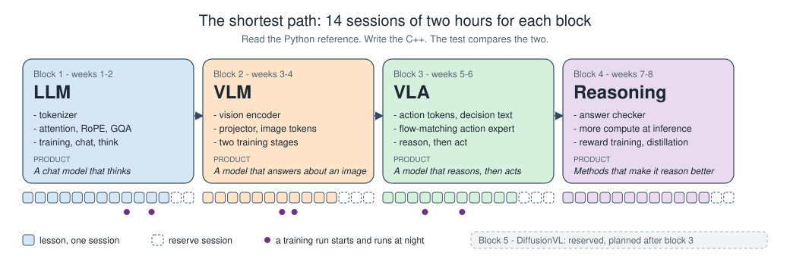
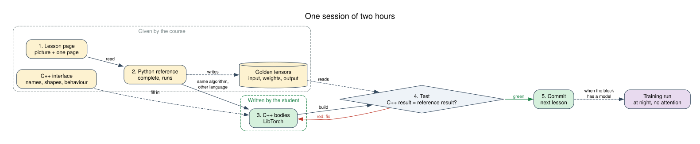

# Plan: objective 1, the lean course

| | |
|---|---|
| Objective | 1: learn the internals of a large language model by building one from scratch (`AGENTS.md`) |
| Date | 2026-11-16 |
| Requirements | [`docs/requirements.md`](../docs/requirements.md) |
| Specification | [`docs/specification.md`](../docs/specification.md) |
| Status | Plan. No lesson is written. |

## 1. What you get

Each night you open one lesson folder. You read one page and one short
Python file. You write the same algorithm in C++ with LibTorch. A test
compares your tensors with the tensors of the Python reference.

The course gives the scaffolding: build files, lesson pages, Python
reference, C++ interfaces with empty bodies, tests, data tools, and the
`main()` of each program. You write all model code.

| Block | Sessions | Lessons | Product | Design that it follows |
|-------|----------|---------|---------|------------------------|
| 1 LLM | 1 to 14 | L01 to L12 | A chat model of 63.9 M parameters that thinks before it answers | Qwen3 at a small size: `minimind` and `LLMs-from-scratch` `ch05/11_qwen3` |
| 2 VLM | 15 to 28 | V01 to V11 | A model that answers questions about an image | `minimind-v`: frozen vision encoder, projector, image tokens |
| 3 VLA | 29 to 42 | A01 to A11 | A model that writes a decision, then a 6.4 s trajectory | Alpamayo-R1 at a small size: action tokens, flow-matching action expert |
| 4 Reasoning | 43 to 56 | own plan | Methods that make the model reason better | `reasoning-from-scratch` |
| 5 DiffusionVL | later | own plan | Reserved | — |

Each block has 12 lessons or fewer and two reserve sessions or more.
The lesson tables are in the specification, sections S-5 to S-9.

## 2. Decisions for you

The plan uses a default for each decision. Each default can change
before the milestone in the last column, and the change stays in one
block.

| # | Decision | Default in this plan | Other choice | Before |
|---|----------|----------------------|--------------|--------|
| D1 | Domain of the VLA block | Driving. Open data (`yaak-ai/L2D`), Alpamayo-R1 design, open-loop metric. | Robot arm (`lerobot/libero`) with a closed-loop success rate in a simulator. Three lessons change. | M3a |
| D2 | Place of reasoning | You touch it two times in the first six weeks: think tokens (L11) and decision-then-action (A03, A08). Block 4 gives the methods and gets its own plan. | Write the block 4 lessons into this plan now. | M4 |
| D3 | The `DiffusionVL/` folder | Read as the DiffusionVL paper (arXiv 2512.15713): change your VLM of block 2 into a diffusion VLM. Reserved as block 5. | A different subject: tell me which. | M5 |
| D4 | Help on the C++ side | Interfaces, doc comments and tests. No C++ solution in the repository. | Solutions on a separate branch. Or step hints in the empty bodies. | M1a |
| D5 | Reference training on your graphics processor | The implementing agent trains the Python reference of each run one time: 24 hours maximum for blocks 1 to 3, at night. This gives the curves and the fallback checkpoints. | Short runs of some minutes only. Then the time limits and the exit numbers are estimates. | M1b |
| D6 | Data | English only. Vocabulary of 6400 tokens, the `minimind` size. | — | M1a |

Note for D5: at the time of the tests, a different process held 11 GB
of the 24 GB of graphics memory. The reference runs are sized for 12 GB.

## 3. Milestones

One milestone is one merge request. It delivers one week of lessons,
before the week starts. You can start session 1 when M0 and M1a are
merged.

| Milestone | Content | Done when |
|-----------|---------|-----------|
| M0 Foundation | Build files, Python environment, `course/` helpers, `.gitignore`, block README files, smoke test, data fetch tool | From a clean clone: `uv sync`, `cmake --preset clang`, `ctest -L smoke` are green. Same with the `gcc` preset. The smoke test runs on the CPU and on the graphics processor and does one tensor exchange in each direction. |
| M1a LLM, week 1 | L01 to L07 | Each test is red with the empty bodies and green with a temporary solution. Each reference runs. |
| M1b LLM, week 2 | L08 to L12, programs, the two reference runs, exit test | As M1a. The curves are in git. The fallback checkpoint is in `runs/reference/`. The exit numbers are measured. |
| M2a VLM, week 3 | V01 to V06 | As M1a. The vision tower test agrees with the pre-trained model. |
| M2b VLM, week 4 | V07 to V11, programs, the two reference runs, exit test | As M1b. |
| M3a VLA, week 5 | A01 to A06, the VLA-0 reference run | As M1a. The VLA-0 curve is in git. |
| M3b VLA, week 6 | A07 to A11, programs, the VLA-1 reference run, exit test | As M1b. `plans.csv`: `implemented` = `yes`, with the commit. |
| M4 Reasoning | Plan `objective-1-reasoning-block.md`, then its lessons | Own plan. |
| M5 DiffusionVL | Plan `objective-1-diffusionvl-block.md` | Own plan. |

## 4. Work order in one milestone

The implementing agent (Opus 5.5) does these steps for each lesson, in
this order:

1. Write the Python reference. Run it.
2. Add the golden writer to the reference. Make the golden file.
3. Write the C++ interface with the doc comments.
4. Write the C++ test. Build with the empty bodies. Record the red result.
5. Write a C++ solution in a temporary folder outside the repository.
   Record the green result. Delete the solution.
6. Write the lesson page. The picture comes first.

Then, for a milestone with training runs: start each reference run,
record time and loss, put the curve in git, set the exit numbers.

The merge request of each milestone has the red and green table of
step 4 and step 5. An agent reviews M0 and M1a, because they set the
pattern for the others.

## 5. Tested before this plan

These tests ran on the machine of the student on 2026-11-16. They
remove the largest risks of the build.

| Test | Result |
|------|--------|
| LibTorch 2.15.0 headers at `-std=c++23`, GCC 15.2 and Clang 21.1 | Compile and run, no error |
| C++ reads a tensor dictionary that Python wrote | Works with `torch::pickle_load` |
| Python reads a checkpoint that C++ wrote | Works with `torch.load` and one allowed type name |
| Same input, Python and C++, CPU: RMSNorm and causal attention | Difference 0 |
| Same input on the graphics processor (RTX 3090) | Difference 7e-7 |
| `bfloat16` mixed precision from C++, on the graphics processor | Works |
| `find_package(Torch)` on this machine | Fails in three ways. The control is in the specification, S-1. |
| Rebuild after an edit, with a precompiled header | Clang 4 s, GCC 15 s |

The CPU tests used PyTorch 2.15.0. The two tests on the graphics
processor used the PyTorch 2.9.1 package that is on the machine. The
first step of M0 repeats them with the 2.15.0 package for the graphics
processor.

## 6. Risks

| Risk | Effect | Control |
|------|--------|---------|
| A lesson is longer than two hours in C++. | The block is late. | Two reserve sessions or more in each block. The long lessons have the mark ◆ for a weekend day. A lesson that fails this rule in M1a is cut in two before M1b. |
| A training run of the student fails or is late. | The next block cannot start. | The reference checkpoint of each block is the fallback (R-2.5). |
| A different process holds a part of the graphics memory. | A run stops for lack of memory. | The runs are sized for 12 GB. The reference run records its peak memory. |
| A model of 64 M parameters is weak. | The answers are simple; the think text is short. | The exit tests measure loss, format and error, not intelligence. Block 4 can load larger pre-trained weights of the same design into the code of the student. |
| The VLA metric is open loop. | A low error does not prove good driving. | Said plainly in the specification, S-7. A closed-loop test is a subject for block 4 or for decision D1. |
| The temporary C++ solutions make the work of the implementing agent larger. | A milestone takes longer. | Accepted: it is the only proof that a test can pass (R-3.8). |
| PyTorch changes. | The reference and LibTorch are not the same version. | The lock file pins 2.15.0. LibTorch comes from the same package. |
| The 2.15.0 package for the graphics processor is not tested on the machine. | The build of M0 needs a correction. | It is the first step of M0. The package needs driver 580 or above; the machine has 595. |
| The stories of the pre-training have few words for images. | The VLM learns slowly. | The pre-training adds the caption text of the block 2 data. Stage 2 can train more LLM blocks; the reference run decides. |
| A data set changes its licence or its access. | A run has no data. | `tools/fetch_data.py` pins the revision of each data set. The specification, S-10, records each licence. The image data of block 2 is for study only. |

## 7. Not in this plan

- The lessons of block 4 and block 5: each gets its own plan.
- Code of the student: the student writes it.
- A change of `AGENTS.md`: rule 6 is in merge request 1.
